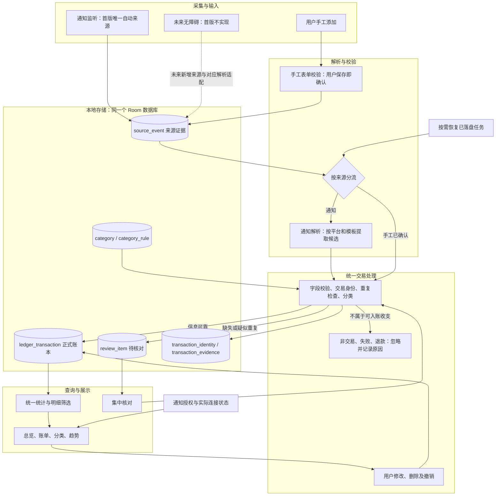

# Android 个人自动记账 App 架构设计草案

日期：2026-11-06。修订范围：根据本轮要求，将第一版收敛为“通知记账 + 用户手工添加、修改、删除”。当前仅编写设计文档，尚未创建 Android 工程；平台机制沿用本日已核对的官方资料，实际支付覆盖仍需真机验证。

## 1. 需求理解与默认假设

目标是减少付款后的逐笔操作：可可靠识别的通知自动记账，关键信息不完整的候选集中待核对；漏采由用户手工添加。通知权限关闭或采集适配失效时，已有账单、手工操作和统计仍然可用。

默认第一版供本人安装 APK 使用；主用户空间、每个平台一个支付账号；建议 Android 8.0/API 26 起；人民币单账本，账本时区固定 Asia/Shanghai。手机型号、ROM、Android 版本、微信/支付宝版本在验证阶段登记。双开、工作资料、多支付账号切换及外币暂不支持。

### 1.1 第一版范围

- 微信、支付宝的通知监听与已验证模板解析。
- 用户手工添加收入或支出，修改金额、日期、商家、类别，删除账单。
- 正式账本、集中待核对、商家分类规则、重复事件防护。
- 月度消费、收入与净支出，类别占比、趋势、环比、上月同期和图表明细联动。
- 采集授权、实际连接、版本及异常状态展示。
- 本地数据存储、进程恢复和数据库版本迁移。

### 1.2 本轮明确移出第一版

- **退款记账与原单联动**：不新增退款账单、不关联退款原单、不自动冲减或删除原消费。仅过滤可明确识别的退款通知，避免被误记为收入。
- **全部文件导入功能**：没有表格或账单文件导入、格式解析、导入预览、批次与文件补漏。
- **导出及用户操作的备份恢复**：随数据导入导出一起暂缓，不提供 CSV、备份文件、恢复入口或相关模块。
- **无障碍服务**：首版不实现、不注册、不申请授权，仅保留采集与账本解耦的结构。
- 截图 OCR、登录、服务器、同步、资产余额、复式会计、云端大模型、全交易实时获取和无限保活。

不为移出的功能提前建立空包、方法、服务、权限、表或字段。

### 1.3 退款与手动删除的含义

原方案中的退款，是付款后资金退回的一笔独立账务事件，并不是自动删除原消费。本轮取消这套处理，改为由用户维护原记录：

- 全额退款后，用户可以删除原消费。
- 部分退款后，用户可以手动把支出改为实际保留金额。例如支出 100 元、退回 20 元，可改为 80 元。
- App 不根据退款通知自动执行上述动作，也不把退款作为普通收入。
- 删除或改金额会重算**原记录日期所属期间**，不在退款发生月生成负支出。因此第一版反映的是用户维护后的消费账本，不提供退款历史或退款现金流分析。

## 2. 技术可行性对比表

| 方式 | 可能覆盖 | 权限/用户动作 | 可靠性与遗漏 | 耗电 | 首版安排与维护成本 |
|---|---|---|---|---|---|
| 通知监听 NotificationListenerService | 支付 App 真正发布且向监听器提供可读字段的系统通知 | 用户在系统设置授权通知使用权 | Android 正式支持回调；某种支付是否有通知、字段是否够用必须真机验证。App 内成功页、聊天消息不等于系统交易通知；不能拉取完整历史 | 低，事件驱动 | **唯一自动采集方式**；适配模板、聚合更新、内容脱敏，维护成本中等 |
| 用户手工录入 | 用户主动填写的收入或支出，补录漏采 | 无采集权限要求 | 以用户保存的字段为准，可修改和删除 | 低，按需 | **基础能力与降级路径**；维护成本低 |
| 只读无障碍 | 用户正在查看且允许读取的页面 | 若未来启用，需要单独授权与验证 | 页面/版本依赖强，敏感节点可能不可读 | 取决于事件过滤策略 | **首版不实现**；仅预留接入边界，未来适配成本高 |
| 普通个人“全部交易 API” | 当前不能按公开可用能力设计 | 未找到满足该范围的公开授权能力 | 截至本日核对，在可核对的公开官方资料中未找到第三方可通用读取全部微信/支付宝个人跨商户交易的接口 | 不适用 | 不作为项目依赖；不对未公开合作能力作断言 |
| 商户支付/查询/账单 API | 商户及其授权业务范围内的订单 | 商户接入、业务权限和签名等 | 不能据此读取一个消费者在所有商户的个人消费 | 通常需联网 | 与本项目采集目标不匹配，不接入 |

通知机制与活动通知范围见 [NotificationListenerService](https://developer.android.com/reference/android/service/notification/NotificationListenerService)。Android 15 对检测到 OTP 的通知有内容保护，不能承诺开启权限即可获得所有明文，也不能泛化成所有付款通知都不可读，见 [Android 15 行为变化](https://developer.android.com/about/versions/15/behavior-changes-all)。

微信与支付宝可核对的账单接口资料描述商户业务范围，并不等于普通个人账单授权，见 [微信支付商户账单](https://pay.wechatpay.cn/doc/v3/merchant/4013071218)、[支付宝商家账单](https://help.alipay.com/enterprise/knowledgeDetail.htm?knowledgeId=201603401890)。此处仅说明接口边界，不引入文件功能。

## 3. 推荐方案及理由

按本轮已确定的选择，采用 **通知自动记账 + 手工补录**。暂不增加其他采集渠道。

1. 通知监听是唯一自动入口。仅对经过真机验证、能区分交易和普通消息、关键信息足够的模板开放自动入账。
2. 手工添加是独立基础能力。没有通知、无法读到通知、权限关闭或模板失效时，用户仍能补记。
3. 金额、状态、日期或重复关系不清楚的候选进入待核对；仅缺分类时直接记入“未分类”，减少操作。
4. 退款消息不产生账务动作；用户自行删除或修改原账单。
5. 后续无障碍通过新增采集与解析适配接入，复用现有账本处理和统计；首版不写空方法、不引入通用插件框架。
6. 使用确定性解析、分类规则和数据库查询。首版没有加入大模型的必要。

如果真机验证发现微信或支付宝某类支付没有可读通知，准确列出该类支付需手工补录；不通过增加保活手段假设可以获得不存在的通知，也不把无障碍作为首版完成条件。

## 4. 总体架构图



虚线仅解释未来接入位置，不代表首版包含无障碍服务。所有圆柱均为同一数据库中的表；修改日志表为简洁省略。手工输入直接提交用户已确认的结构化字段，不伪造通知，也不经过通知文本解析。

采集器只收集来源证据，解析器只输出候选，统一处理层决定入账，统计只读取正式账本。通知解析器不能直接操作统计或删除账单。

## 5. 技术栈与项目结构

| 选择 | 实现与理由 |
|---|---|
| Java + XML Views + ViewBinding | Activity/Fragment、RecyclerView、Material 控件；符合现有语言基础，避免同时学习 Kotlin 与新 UI 模型 |
| ViewModel + LiveData | 保存页面筛选与加载状态；数据库变更后刷新账单和统计，避免界面轮询 |
| Room 2.x + SQLite | Java 注解处理、实体、DAO、SQL 校验、事务和迁移；核对时 2.x 稳定线为 2.8.5，实施时锁定兼容补丁 |
| ExecutorService + WorkManager | 后台执行短解析与数据库写入；WorkManager 仅用于已落盘事件的按需重试和恢复，不承担支付采集或准点保证 |
| java.time + long / BigDecimal | 显式处理日期、时区与金额精度 |
| 小型 Java ChartView + 数据列表 | 画 6/12 个点的趋势及类别图，仅负责绘制和点击；金额仍由数据库和整数计算 |
| 本地配置 | SharedPreferences 保存界面设置、账本时区、本地支付账号别名和 UUID，不是登录系统 |

官方 Room 2.x 支持纯 Java 的 annotationProcessor；Room 3 转向 Kotlin 生成、KSP 和协程，不能直接照搬 2.x 配置。因此本项目优先 Room 2.x，见 [Room 2.x](https://developer.android.com/jetpack/androidx/releases/room)、[Room 3 变化](https://developer.android.com/jetpack/androidx/releases/room3)。Compose 以 Kotlin 为中心，首版采用传统界面，见 [Kotlin for Compose](https://developer.android.com/develop/ui/compose/kotlin)。

建议 minSdk 26；compile/target 使用实施时官方稳定 SDK，并测试本人 ROM 与当前系统版本，见 [Android 17 适配资料](https://developer.android.com/about/versions/17)。构建 JDK 按所选 AGP 的兼容要求确定。

只建一个 app Gradle 模块，按职责分包：

```text
app/
  ui/                    总览、账单、统计、待核对、设置、手工编辑
  capture/notification/  通知服务与最小必要字段提取
  parsing/               微信/支付宝通知模板与结构化候选
  processing/            校验、去重、分类、统一保存、修改和删除
  data/                  Room 实体、DAO、迁移与少量 Repository
  stats/                 筛选条件、时间区间、汇总与变化解释
  health/                通知授权、实际连接、版本和异常诊断
  worker/                已落盘事件的按需恢复
```

依赖方向：页面 → Repository/统计查询 → DAO；通知 → 来源证据 → 解析/处理 → DAO。用一个手工 AppContainer 传依赖即可，暂不引入 Hilt、事件总线、大量接口层或多模块。

### 后续接入无障碍的边界

- 来源证据保存通用元数据：来源类型、平台/包名、版本、采集时间、原始载荷和解析结果，不把全部来源强制成通知字段。
- 通知特有的 key、频道、发布时间等放在对应来源载荷中，不成为账本必填字段。
- 处理层只接受统一交易候选及字段证据，不依赖通知类或通知服务。
- 未来新增无障碍采集与对应页面解析适配，再增加一种来源类型，复用身份匹配、分类、待核对、账本和统计。
- 未来同一交易同时来自通知和页面时，复用身份与证据关联处理，不能各记一笔。
- 首版没有无障碍空实现、权限、设置开关或方法签名；本设计只确定职责和依赖边界。

## 6. 核心数据模型

本地主键采用 UUID 字符串。平台订单号保存为 TEXT；金额保存为 SQLite INTEGER / Java long，单位分，币种独立。写账、去重身份、来源关联和事件完成标记在同一数据库事务内提交。

### 6.1 状态与类型

- 正式交易类型仅为 EXPENSE、INCOME。不设置退款类型或退款关联字段。
- 来源支付状态保留 SUCCESS、PROCESSING、FAILED、CLOSED、UNKNOWN 及必要原文；明确属于退款的通知直接按不支持的事件忽略。
- 来源处理状态为 NEW、DONE、REVIEW、IGNORED、ERROR，不需要文件暂存状态。
- 账单状态为 POSTED、DELETED。用户看到的是“删除”，内部逻辑删除以停止统计并防止旧消息重新入账。
- 不属于消费/收入的明确充值、提现、还本金等通知忽略；用途不明确的到账先核对，不直接当收入。

### 6.2 核心表

| 表 | 主要字段 | 关联、索引和约束 |
|---|---|---|
| source_event | id、source_type(NOTIFICATION/MANUAL)、provider、account_scope_id、package_name/app_version、captured_at_ms、source_time_raw、raw_payload、payload_hash、event_key、parser_id/version、parsed_json、process_state、error_code | UNIQUE(source_type,event_key)；索引(process_state,captured_at_ms)。来源特有字段在载荷中，手工来源保留最小结构化输入；原文可按保留策略清空 |
| ledger_transaction | id、kind(EXPENSE/INCOME)、amount_minor、currency、occurred_at_ms、time_precision、source_zone_id、merchant_raw/normalized、provider、account_scope_id、pay_method_raw、category_id/category_origin、applied_rule_id、booking_state、deleted_at、user_locked_fields、note、revision、created_at/updated_at | amount_minor>0，CNY；类别及规则 FK；索引(booking_state,currency,occurred_at_ms)、(category_id,occurred_at_ms)；没有 refund_of_id 等退款字段 |
| transaction_identity | id、transaction_id、provider、account_scope_id、id_kind、id_namespace、external_id | UNIQUE(provider,account_scope_id,id_kind,id_namespace,external_id)，唯一键各列 NOT NULL；订单号只在确实取得时建立身份，不伪造 ID |
| transaction_evidence | event_id、transaction_id、linked_at、match_method | event_id 为 PK/FK，一个候选事实至多关联一笔账单；transaction_id 建索引。一笔账单可有多条通知证据，未来也可关联页面证据 |

identity 的作用是去重，不要求每笔通知都有订单号。平台交易号和商户订单号分类型保存；商户订单号必须有可靠商户命名空间，不能全局只按编号去重。没有确定身份时保留事件防重与疑似重复核对路径。

account_scope_id 是“微信本人”“支付宝本人”等本地稳定 UUID，不存账号密码；手工记录可以选择其他渠道。默认账号范围不能被通知包名自动推导为任何账号，切换支付账号须另行设置，首版不自动识别双开。

### 6.3 支持表

| 表 | 主要字段 | 约束/用途 |
|---|---|---|
| category | id、name、flow_scope、sort_order、archived | 收入/支出平级类别即可；内置对应的未分类，归档保留历史关联 |
| category_rule | id、provider/scope_filter、match_type(EXACT/PREFIX/CONTAINS)、merchant_pattern、category_id、priority、enabled、version | 类别 FK；先按优先级，再按匹配精度和长度；同序冲突回到未分类，不使用任意正则 |
| review_item | id、event_id、transaction_id(可空)、reason_code、details_json、resolution_state、resolved_action、created_at/resolved_at | event FK；UNIQUE(event_id,reason_code)；索引未解决状态；没有退款关联核对和导入异常类型 |
| change_log | id、transaction_id、action、before_json、after_json、actor、reason、event_id、created_at | 记录修改、删除、撤销、合并，按账单和时间索引；与账单操作在同一事务中写入 |

字段值范围能用 CHECK 表达时在迁移 SQL 中约束；所有 FK 子列建立必要索引；不使用会先删旧行再插入的 REPLACE 处理交易身份冲突。

### 6.4 金额与时间

28.80 元保存为 2880 分。解析先定位“实付/支付金额”，再规范化币符号、空格和已验证的千分位；使用 BigDecimal 从字符串精确转换为 long。超过两位小数、溢出或未知币种进入待核对，不静默舍入。手工输入同样校验，金额必须大于零。

成交时间与采集时间分别保存。可信来源时间按其时区解释；已验证的本地人民币模板没有时区时，按 Asia/Shanghai 解释并记录假设。只有可靠日期时标 DAY 精度，不伪装精确时刻；仅有通知到达时间而无法确定成交日期时进入待核对。手机换时区不改变已有账单归月。

## 7. 关键业务流程

### 7.1 一笔付款怎样进入月度统计

假设 2026-11-05 12:10，微信向“午间面馆”支付 28.80 元。以下是字段确实可得时的流程，不代表该支付路径一定产生通知：

1. 系统回调通知，采集层先按包名及已验证交易类型/结构过滤，只复制必要字段，后台持久化来源事件。
2. 微信模板解析器输出候选：EXPENSE、2880 分、CNY、商家、可信成交日期、SUCCESS，订单号和支付方式取得多少就保存多少。
3. 统一处理层校验金额、状态、日期和账号范围，检查身份与疑似重复。
4. 命中“午间面馆 → 餐饮”规则。
5. 同一事务内写账单、可得身份、来源证据，并把事件改为 DONE；任何一步失败则回滚。
6. 统计只读 POSTED，11 月消费总额与餐饮金额增加 28.80 元，页面更新；点击餐饮图表进入该范围明细。

包名加“支付成功”关键词不足以证明交易，普通聊天和营销必须排除。明确的退款、失败和非收支事件不会入账。关键信息缺失则进入待核对，仅缺商家或分类可用“商家未知/未分类”入账。

### 7.2 手工添加与通知漏采

用户打开新增页，填写类型、金额、日期，选择或补充商家、渠道、分类和备注，按保存即确认。日期默认当前，类别可由规则建议；不再要求第二次确认。

手工输入经表单校验后产生 MANUAL 来源与结构化候选，复用保存、分类和统计逻辑，不走通知文本解析。发现与已有账单相似时给出提示并允许用户确认另记一笔，不能仅凭同额自动拒绝。

若真实付款没有通知，App 不会知道存在漏采。用户可自行查看支付 App 的账单，再在本 App 手工添加；本 App 不自动读取这些页面，也不要求文件。

手工补录之后若迟到通知到达，使用下述去重路径。无确定订单号的相似记录只能建议关联，不能静默合并。

### 7.3 去重、合并与防止删除后重记

分三层：

1. **同一事件重放**：通知事件键包含账号上下文、通知 key、postTime 与规范化内容摘要；完全相同的事件只处理一次。手工保存使用稳定的本次提交标识，防止连点或提交重试重复创建。
2. **确定交易身份相同**：命中身份唯一约束，只挂接证据，不新增账单；若已删除，保留删除状态。
3. **没有确定身份但疑似重复**：金额、方向、商家、时间精度/窗口等用于生成匹配建议，新候选先待核对。必要时对照来源证据和修改前值，不能只比较用户编辑后的金额或日期。无重复迹象且满足入账条件才新增。

通知 key 是通知槽位，不是订单号；同 key 更新、复用、重发要单独判断。不能因同店一分钟内两次同额付款就自动删掉一笔。

用户确认合并时，保留主账单，转移证据和身份，将重复账单逻辑删除并记日志。逻辑删除保留必要身份、事件摘要与来源关联，后续同事件或同订单不自动恢复；不能因此屏蔽另一笔真实同额交易。没有稳定身份的相似重发只能待核对，不能保证自动认出所有旧记录。

### 7.4 分类

人工锁定类别 > 已确认商家规则 > 默认未分类。规范化只做安全的空格、大小写和已验证别名处理，保留商家原文，不随意删门店名称或数字。

用户修改类别时可选择“以后同一商家都这样分类”。新规则默认影响后续；历史批量重分类先预览数量，人工锁定记录不覆盖。规则冲突只影响类别，不阻塞可靠交易入账。

### 7.5 删除、手动处理退款及金额修改

第一版**没有退款账单与退款流程**。退款通知可明确识别时直接忽略；不作为收入、不自动删原单、不改变原支出、不创建退款待核对任务。

用户因全额退款或记错而删除账单时：

1. 列表明确显示将删除的记录和金额，允许撤销。
2. 同一事务中将账单设为 DELETED、记录删除时间与日志；最小去重信息保留。
3. 页面不再显示为有效账单，所属日期的总额、类别、趋势、同期比较重新计算。
4. 旧通知重放不自动复活该记录；撤销删除是用户显式动作，与数据备份恢复无关。

部分退款时，用户可把金额改为最终保留支出。例如 100 元改 80 元，原消费月份减少 20 元；不在退款当月另记 20 元收入。跨月全额退款后删除 11 月消费，变化也落在 11 月，而不是 12 月。第一版采用这一简化账本口径。

### 7.6 人工修改、冲突与异常恢复

金额、日期、类型、类别等人工修改带字段锁和日志，后续通知不覆盖锁定字段。已有 POSTED 账单收到冲突新证据时，保留最后接受版本并提示待核对，不重复计入；用户处理后事务更新并重算。

已删除账单的新证据按 7.3 防重；修改日期后分别重算旧、新日期所在期间。撤销、修改、合并都复用同一数据操作入口，避免页面直接写多个表造成部分成功。

已落盘 NEW/ERROR 事件可幂等重试；正式账单、身份、证据和事件 DONE 标记原子提交。打开 App、服务重新连接及任务重启时检查未完成项，不轮询支付 App。

未知疑似交易模板进入核对，明确普通消息忽略；模板不支持不无限重试。解析器升级先跑脱敏样本，仅对仍有原文的未解决事件重新解析，不自动重新记入已删除或已完成事件。

进程在通知回调与落盘之间被杀，仍可能丢失事件。WorkManager 无法补回从未收到或从未落盘的内容；记录可能漏采区间，提示用户检查并手工补录。

## 8. 统计设计

### 8.1 统一公式

默认只统计 CNY、POSTED、指定账本时区和区间内的有效账单。未入账待核对候选与 DELETED 不计；未分类有效账单计入。已有账单的新冲突保留最后接受值并显示争议提示，不额外增加新候选。

- E：支出 EXPENSE 合计，即“消费总额/消费支出”。
- I：收入 INCOME 合计。
- N = E − I：净支出；可以为负，表示收入超过支出。

首版不设置退款合计、退款前消费、退款后净消费或退款冲减公式。总览只展示 E、I、N。

充值、提现、还本金等明确非生活收支通知忽略；借款、人际到账、报销等用途不明确先核对，不能看到“到账”就视为收入。手工记录以用户选择的收入/支出为准。

### 8.2 类别、占比与趋势

类别 c 的消费额 Ec 是该类别 POSTED 支出之和。所有支出类别含未分类的合计必须等于 E。

E>0 时，占比=Ec/E×100%；E=0 时显示暂无已记支出，不除零。类别金额均来自正值支出，不需要退款引起的负类别处理。展示舍入不影响整数金额及总额。

近半年/一年默认包含当月的 6/12 个自然月，当月标“截至当前、未结束”。自选日期界面包含起止日期，查询转换为 [起日00:00, 终日次日00:00)。某类别跨月变化使用同一序列加类别筛选。

无记录月份可补零绘图，但说明“暂无已记记录”，不能宣称现实消费为零或采集完整。用户修改金额或删除历史账单，会改变相关历史图表，不保留退款发生月的独立曲线。

### 8.3 环比与同期

已结束月的支出环比：

- 变化金额 Δ=E本月−E上月。
- 上月 E>0 时，变化比例=Δ/E上月×100%。
- 上月为零、本月大于零，显示“新增 X 元”；两月均零，显示“无变化”。

收入及净支出卡片可展示变化金额；净支出可能为负，第一版不计算其变化百分比，避免零基数和负基数误导。

未结束月默认比较相同数量的完整自然日：今天为本月 d 日，上月天数 p，k=min(d−1,p)，比较两月前 k 个完整日。2026-11-06 比较 11/1—11/5 与 10/1—10/5；本月总额仍包含今天截至当前的记录，同期卡片另标截止日期。月初第 1 天不算同期比例；大小月明确显示“前 k 天”，不把不同天数冒充同期。

### 8.4 用类别变化解释总变化

每类 Δc=Ec本期−Ec基期；ΣΔc=总支出变化。按增减金额排序，展示主要变化和精确相加的其他变化，不推测没有证据的生活原因。

例：餐饮 600→800，增加 200；交通 400→300，减少 100；总支出 1000→1100，增加 100、10%。解释为“餐饮增加 200 元，交通减少 100 元，合计增加 100 元”。

两个期间使用相同类别定义与筛选条件；用户历史重分类后两个期间一起重算，修改日志可追溯。

### 8.5 查询、下钻与预算扩展

统计和明细共用筛选条件：起止时间、账本时区、币种、指标、类别、渠道范围及 POSTED 状态。点类别图进入对应支出，点收入卡片进入对应收入；净支出明细给支出正贡献、收入负贡献，带符号合计等于 N。已删除记录不进入任一有效汇总。

时间边界由 Java YearMonth/LocalDate/ZoneId 计算后绑定数据库查询，不依赖设备可变时区。个人规模先直接查询，6/12 月汇总使用同一读取快照，不提前建月汇总表；绘图坐标可用浮点，金额保存、求和与展示仍使用整数分。

预算留后续：按月度总额或类别建立预算范围，按 E 检查；修改金额或删除记录会重算使用量。新增/修改/删除/撤销/类别变化后触发阈值检查，按月份、预算和阈值去重提醒，不靠后台轮询。首版不建立预算表或提醒任务。

## 9. 页面与交互设计

底部导航：总览、账单、统计、待核对；设置从总览进入，保持明显的手工新增入口。

| 页面 | 内容与动作 |
|---|---|
| 总览 | 月份、消费 E/收入 I/净支出 N、同期、类别变化解释、通知采集状态、待核对数、手工添加 |
| 账单 | 日期列表和类型/类别/渠道筛选；详情看来源、订单尾号、时间精度、分类依据；手工添加、编辑、删除、撤销删除 |
| 统计 | 类别金额/占比、6/12 月趋势、自选范围、类别变化；点击进入相同筛选条件下的明细 |
| 待核对 | 疑似重复、金额/方向/状态/日期不明、疑似交易解析失败；显示原因和建议，支持预览后的分类、确认、关联、另记一笔或忽略 |
| 通知采集设置 | 通知使用权、实际连接、最近事件和解析成功、支付 App 与解析器版本、可能漏采区间和手工补录提示 |

文本示意：

```text
2026 年 11 月             通知采集：已连接
消费 1,288.80    收入 3,000.00    净支出 -1,711.20
同期：前 5 天比上月前 5 天 +80.00
餐饮增加 120.00，交通减少 40.00
[点击类别条形图进入明细]
待核对 3 笔                       [集中处理]
[手工添加]
```

自动入账默认静默，不弹逐笔确认、不强制悬浮窗。手工保存一次即完成；分类修改可建立商家规则。删除可以从账单列表或详情执行，提供撤销，界面不需要用户理解逻辑删除。

首版页面没有文件导入、导出、备份恢复、退款专区、无障碍授权或 OCR 入口。没有通知权限也能进入手工账本和统计。

## 10. 权限、后台运行与隐私设计

### 10.1 通知授权与实际连接

通知服务声明绑定权限 BIND_NOTIFICATION_LISTENER_SERVICE，由系统绑定；用户在系统通知使用权页面主动开启。POST_NOTIFICATIONS 只决定本 App 能否发提醒，不能代替通知监听授权，见 [通知运行时权限](https://developer.android.com/develop/ui/compose/notifications/notification-permission)。首版如没有主动提醒需求，不为读通知额外申请发送通知权限。

收到通知先按微信/支付宝包名，再按交易结构过滤。普通聊天不存原文；明确退款和非交易只保留必要忽略原因，不收集支付密码或其他通知。系统授权范围较广，授权说明需如实交代。读取目标 App 版本如需包可见性，只声明目标包。

Android 13+ 部分侧载安装可能受受限设置保护，按系统允许的用户确认流程处理；无法授权则用手工记账，不以 root/ADB 为产品前提，见 [受限设置官方说明](https://support.google.com/android/answer/12623953?hl=en)。

健康页把系统授权、当前实际连接和最近事件分开。仅在本进程收到系统连接回调后标为已连接；上次连接时间不能代替当前状态。断连后有限制地请求重绑，失败提示检查；长时间无消费通知本身不能证明断线。重连只补抓仍活动的通知，不能读取完整历史。

### 10.2 进程、重启与后台限制

正常进程回收后依赖系统重绑和已落盘任务恢复。重启后等待解锁访问凭据加密区中的 Room 数据；WorkManager 仅恢复已经提交的工作，不保证精确即时或零遗漏，见 [WorkManager](https://developer.android.com/develop/background-work/background-tasks/persistent)。

用户强行停止与普通进程回收不同，需要用户重新启动/交互恢复，见 [Android 15 停止状态行为](https://developer.android.com/about/versions/15/behavior-changes-all)。不循环拉起服务、不滥用闹钟或常驻前台服务保活；后台启动前台服务也受限制，见 [前台服务限制](https://developer.android.com/develop/background-work/services/fgs/restrictions-bg-start)。

不后台打开支付 App、不轮询页面、不常持唤醒锁。OEM 省电设置仅在验证实际断连后给出对应说明。权限关闭期间停止采集，手工账本、修改删除和统计照常使用；漏采由用户手工补录。

### 10.3 本地存储与保留

Room 位于应用私有存储，依赖系统应用隔离和设备凭据加密；Room 本身不代表数据库内容加密。不接广告、统计 SDK、云端日志或大模型，首版没有业务联网需求，检查最终合并清单不含不必要权限。不申请无障碍、截图、短信、联系人、定位或全盘文件权限。

原始通知文本默认保留 7 天，正式账单与最小结构化证据保留到用户处理或清除数据。未解决记录清理原文前提示可能失去重解析能力；可以由用户选择延长或清除原文。日志只写事件 ID、版本、错误码，不默认记录完整订单号或通知全文。

删除账单采用逻辑删除保留防重信息，用户可撤销；清除 App 全部数据是不同操作，不拿逻辑删除冒充敏感数据已物理清除。

### 10.4 数据保留边界与版本迁移

首版不提供用户操作的数据导入、导出和备份恢复。因此卸载、清除应用数据或设备损坏时，没有本 App 提供的恢复入口；正常版本升级应通过 Room 迁移保留本地账本和去重依据。

默认排除敏感账本及通知内容的系统云备份和设备迁移，按系统版本配置 allowBackup、fullBackupContent/dataExtractionRules 并真机核对，不能只设置 allowBackup=false 就假定所有厂商 D2D 都关闭，见 [Android Auto Backup](https://developer.android.com/identity/data/autobackup)。这是本地隐私边界，不是新增备份产品功能。

数据库升级保留身份、删除标记和日志，缺失迁移路径时明确失败，不能自动删库重建。若以后明确需要跨设备或文件功能，再单独设计，不预建加密数据包和恢复流程。

### 10.5 未来无障碍与发布边界

首版没有无障碍服务组件和权限。未来新增前再验证实际页面可读性、敏感视图限制、用户披露与目标渠道要求；不能以伪报辅助工具身份获取受保护内容，见 [敏感视图保护](https://developer.android.com/privacy-and-security/risks/tapjacking)、[Google Play 无障碍政策](https://support.google.com/googleplay/android-developer/answer/10964491?hl=en)。

当前按个人安装设计。国内商店及备案等要求未逐家核实；确定发布渠道后再查当前官方要求，不承诺上架。

## 11. 分阶段开发计划

以下是设计路线与验收，不代表当前已经创建或验证了 Android 工程。通知效果不足时保留手工使用，不把无障碍、文件或退款功能加回第一版。

| 阶段 | 交付内容 | 验收标准 |
|---|---|---|
| 0：验证通知事实 | 本人手机/ROM/系统/支付 App 版本矩阵；最小通知观测验证；脱敏通知样本与模板字段清单 | 覆盖主动扫码、付款码、线上支付、代扣及前后台；人工查看支付 App 记录作参考，分别记录有无通知、字段、可否入账和遗漏。明确退款消息不入账。分别计算覆盖率、正确率，不用模拟通知证明真实覆盖 |
| 1：通知与手工账本 MVP | Java 单模块；Room 核心表/迁移；手工添加修改删除与撤销；分类规则、待核对、去重；已验证通知模板；基本月度/类别统计与明细；基础授权状态 | 手工保存一次成功；通知重放不重复；手工补录与迟到通知可核对；退款通知既不新增收入也不删除原单；删除即重算且旧消息不自动复活；写入崩溃原子回滚；关闭权限可继续手工使用 |
| 2：完善首版统计与可靠性 | 6/12 月、自选范围、类别趋势、环比与同期、类别解释、图表下钻、完整健康页、重连/重启恢复和连续个人试用 | 图表与明细一致；大小月/月初/跨年正确；手工改日期/金额及删除重算正确；至少连续 7 天人工对照支付 App 记录，统计漏采、误记、待核对率和额外耗电，不要求文件 |
| 后续可选：增强采集与预算 | 确有需求再增加只读无障碍及对应解析；总预算、类别预算、超支提醒 | 新来源复用既有处理，不改账本/统计主链路；通知与页面不重复入账；不可读页面安全降级；预算跟随有效账单变动且提醒去重 |

阶段 0 若证明某平台多数日常支付没有可读通知，应明确“该类支付暂需手工记账”，而不是承诺首版可以自动覆盖，或默认启动其他渠道。

## 12. 测试与风险清单

### 12.1 首版真机场景

| 场景组 | 必测内容 |
|---|---|
| 支付路径 | 微信/支付宝主动扫码、付款码、线上/小程序支付、免密代扣；支付 App 前台/后台、锁屏、断网恢复 |
| 字段与业务 | 实付/优惠/原价并存、缺商家/订单/日期、聚合通知、成功/失败/处理中、红包/转账/充值/还款、退款通知识别后忽略 |
| 通知生命周期 | 同 key 更新/复用、清除后重发、摘要与子通知并存、重连补抓、隐私隐藏/OTP 脱敏、聊天仿写支付成功 |
| 手工操作 | 添加收入支出、连点保存、编辑类型/日期/金额/类别、全额退款后手工删除、部分退款后改金额、删除撤销、手工补录遇迟到通知 |
| 系统生命周期 | 普通进程回收、划走任务、强行停止分别测；重启解锁、通知权限撤销、省电/深度待机、存储不足、App 升级 |
| 环境差异 | 本人 ROM 必测，可借设备再覆盖其他品牌与当前 Android 版本；双开/工作资料/多支付账号默认未支持，不冒充已适配 |

无障碍页面、OCR 和文件处理不属于首版测试任务；未来启用相应能力时再补验证。

### 12.2 数据正确性验收

- 金额：0.01、28.80、大金额、千分位、额外小数、负号、溢出、币符号和优惠混入；手工输入同样校验。
- 时间：月末、延迟通知、仅日期、缺日期、设备与账本时区不同、大小月、闰年、跨年；半开区间无双计。
- 去重：同事件重复 100 次只处理一次；同店同额两笔不自动吞单；同订单多证据；不同账号/商户同编号不混并；手工补录的迟到通知先匹配或核对。
- 删除防重：逻辑删除后统计减少；同事件/同订单重发不恢复；无稳定身份的相似重发先核对，不误屏蔽真实新付款；用户显式撤销能恢复。
- 退款边界：退款成功、部分退款、原付款后收到退款状态都不自动新增/改动/删除账单，不误记收入；手工删除减少原月份，部分退款后改金额只影响原记录；旧金额付款通知重发时结合原始证据防重，不覆盖人工金额或再记一笔。
- 事务与编辑：写账后标记事件前崩溃仍整体回滚；并发来源不重复；人工锁定不被通知覆盖；删除/撤销和日志一致；改日期重算两个期间。
- 统计：Σ支出类别=E、N=E−I、Σ类别变化=总支出变化；图表=对应明细合计；零基数不除零；净支出可负；未分类计入、未入账待核对与已删除不计。
- 持久化：所有 Room 迁移保留账单、身份、删除标记和日志；不为修升级失败调用破坏性重建，见 [Room 迁移](https://developer.android.com/training/data-storage/room/migrating-db-versions)。
- 隐私与电量：最终清单无首版不需要的权限和服务；无业务联网；普通聊天不落盘；系统自动备份排除和日志脱敏；无支付时没有周期扫描或常持唤醒锁，同机对照观察额外耗电。

Java 单元测试覆盖解析、金额、分类、筛选和日期比较；Room 仪器测试覆盖唯一约束、外键、事务、逻辑删除及迁移。需要真实支付 App 或系统行为的部分必须真机验证。

### 12.3 风险与待验证事项

1. 各类付款是否有可读通知、字段是否足够，尚未真机确认；不保证所有付款实时入账。
2. 首版只有通知自动采集，漏采只能手工补录；App 无法知道所有未收到的交易。
3. 退款全由用户维护原记录，删除会改变历史消费月，不提供独立退款历史或退款发生月现金流。
4. 没有导入、导出和用户备份恢复；正常升级保留数据，卸载或清除数据没有本 App 的恢复入口。
5. 支付 App 更新、系统内容保护和 OEM 后台策略可能影响通知；账号切换、双开和工作资料需另验证。
6. 后续无障碍只预留结构边界；实际读取能力、授权和发布规则需启用时重新核对。

以上边界已同步到架构、表结构、业务流程、统计、页面和开发验收。首版仅实现通知与手工账本，不因后续可能扩展而提前增加功能。
